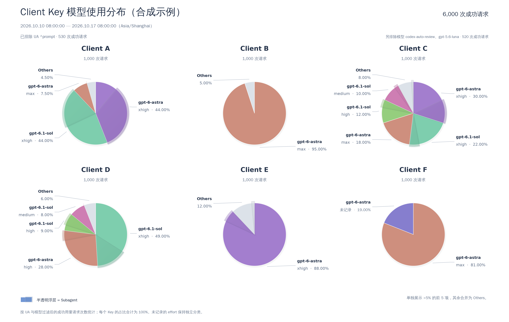
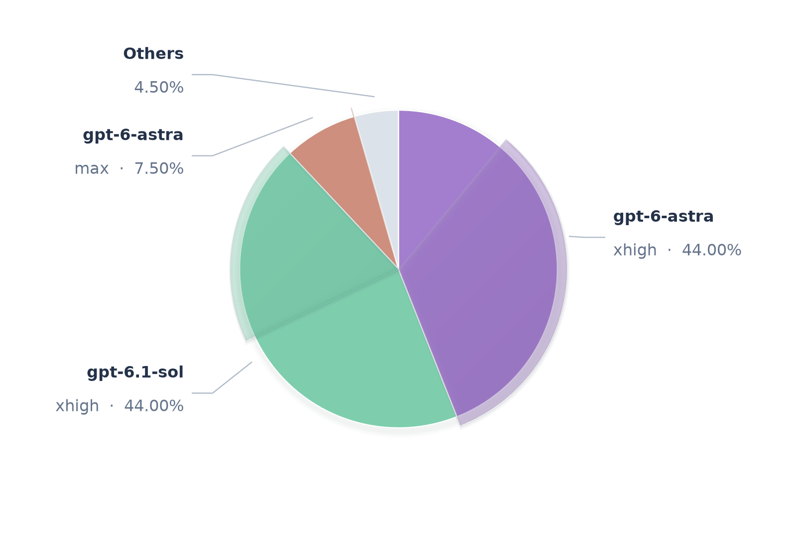

# Codex Proxy Reports

A standalone `codex-proxy-rs` plugin for Client Key usage-distribution reports, targeting **`~3.29.0`**. It includes a Rust backend, an embedded admin page with browser SVG charts, and a synthetic visual reference.

The plugin provides an embedded admin page with explicit report submission and historical report viewing. The host owns request history and the successful-usage definition. The plugin backend filters and aggregates requests, runs one report task at a time, and saves aggregate counts; the frontend calculates percentages and renders the report and charts. It uses existing host capabilities without host changes or database credentials.

Build with Node.js 24+, Rust 1.97, and the host v3.29 packaging CLI (`cpr-plugin`):

```sh
npm ci
npm run plugin:build
CPR_PLUGIN=/path/to/cpr-plugin npm run plugin:package
```

The default output is `dist/packages/huwei.usage-reports-0.1.2-x86_64-unknown-linux-gnu.tar.gz` with a SHA256 file. Install this archive through the host plugin manager and open **Usage reports**. The plugin requires no instance configuration or request middleware bindings. Set `REPORTS_BINARY` and `REPORTS_TARGET` when packaging a binary built for another supported platform.

CI runs Rust formatting, Clippy, backend tests, JavaScript tests, browser tests, and installation/acceptance on the official host v3.29.0. The [Release workflow](.github/workflows/release.yml) runs when a version tag is pushed. Run `npm run version:set -- X.Y.Z` with a new stable version, commit the updated version files, create the matching annotated tag `vX.Y.Z`, then push `main` and the tag with `git push --atomic origin main vX.Y.Z`. The workflow checks that the tagged commit belongs to `main`, tests the exact Linux x86_64 package, uploads it with checksums and signed provenance, then verifies public downloads. Existing releases are never overwritten. The [CI workflow](.github/workflows/ci.yml) also runs for pushes to `main` and pull requests.

Run `npm run demo` and open `http://127.0.0.1:4173/` to try the interface with synthetic data. The demo opens on Reports with synthetic examples ready to browse. New report opens a two-step Configure → Review wizard; generation progress and report reading have separate views. It also supports configuration reuse, host theme synchronization, and chart enlargement. It does not read host history. Run backend checks with `cargo test --manifest-path backend/Cargo.toml --locked`, chart checks with `npm test`, and browser checks with `npm run test:ui` (install Chromium with `npx playwright install chromium`). For isolated host acceptance, run `npm run test:integration -- --host-binary /path/to/codex-proxy-rs --host-web /path/to/web/dist --package dist/packages/huwei.usage-reports-0.1.2-x86_64-unknown-linux-gnu.tar.gz --browser`; this starts disposable PostgreSQL and Redis containers and removes its test services afterward.

- [Data collection](#data-collection)
- [Visualization logic](#visualization-logic)
- [Visualization styling](#visualization-styling)
- [Reproduce the visual reference](#reproduce-the-visual-reference)
- [Deferred and to discuss](#deferred-and-to-discuss)

## Data collection

### Read existing host history

The SDK and packaging baseline is upstream **v3.29.0**, commit [`45954899e53081a2e775fb9351e22908e85221c7`](https://github.com/zyycn/codex-proxy-rs/tree/45954899e53081a2e775fb9351e22908e85221c7). The manifest declares the v3.29.x release line. Management uses capability v2; maintenance uses v1; the SDK and CLI use process protocol v4.

A plugin can call the existing admin endpoint through `HostClient::dispatch_http`, which uses the host's internal routing and plugin identity. The page calls its own registered plugin management routes through the page bridge. See the [host HTTP dispatch and management-page contracts](https://github.com/zyycn/codex-proxy-rs/blob/45954899e53081a2e775fb9351e22908e85221c7/backend/crates/gateway-plugin/sdk/docs/capabilities.md).

```text
Plugin page → confirm configuration → submit report task

Host maintenance callback
  → HostClient::dispatch_http
  → GET /api/admin/usage/records
  → filter and aggregate request counts
  → save completed report data in host.state

Plugin page → poll task → read saved report data → render report and charts
```

The existing endpoint accepts `status=success`, `clientApiKeyId`, explicit `startTime` / `endTime`, `currentPage`, and `pageSize`. It returns the model fields, `reasoningEffort`, `subagentKind`, `userAgent`, and a request ID. Query by stable Key ID and use the Key name for display; `host.keys.list` supplies IDs and names. The page response does not include the Key ID on every row, so retain the ID used for each query. See the [query fields](https://github.com/zyycn/codex-proxy-rs/blob/45954899e53081a2e775fb9351e22908e85221c7/backend/crates/gateway-api/src/admin/observability/query.rs) and [response fields](https://github.com/zyycn/codex-proxy-rs/blob/45954899e53081a2e775fb9351e22908e85221c7/backend/crates/gateway-api/src/admin/observability/wire.rs).

The typed `usage.records.list` service does not expose all the request metadata required by this report. Also, `usage.aggregates.list` reads caller-maintained aggregate contributions; it is not a grouped query over all native request history. Their [record](https://github.com/zyycn/codex-proxy-rs/blob/45954899e53081a2e775fb9351e22908e85221c7/backend/crates/gateway-plugin/sdk/src/call/services/usage/record.rs) and [aggregate](https://github.com/zyycn/codex-proxy-rs/blob/45954899e53081a2e775fb9351e22908e85221c7/backend/crates/gateway-plugin/sdk/src/call/services/usage/aggregate.rs) contracts should not be treated as a complete replacement for the admin endpoint.

The reader scans retained host history afresh for each generation. Process one page at a time and discard its raw records after aggregation. Keep only the current task's scan position and aggregate counts in working memory; do not cache request history or reuse earlier reports as inputs to a new scan. No request-observation middleware, independent request database, or production database credential is needed.

Use `pageSize=100`, the endpoint's maximum. The [observability page-size type](https://github.com/zyycn/codex-proxy-rs/blob/45954899e53081a2e775fb9351e22908e85221c7/backend/crates/gateway-admin/src/model/observability.rs#L13-L26) fixes this limit in host code; it is not a deployment setting. Raising it requires a host change and is outside the first version.

A complete sequential read measured on 2026-10-17 against host v3.28.0 scanned **63,345 successful requests across six Keys in 637 pages**, taking **61.96 seconds**. The probe called the admin endpoint on the host container network and aggregated pages as they arrived; it did not include plugin RPC, report persistence, or browser rendering. This is measurement evidence for asynchronous submission, not a plugin completion-time guarantee.

Report generation follows this lifecycle:

1. Choose **New report**, configure the time range, timezone, and exclusions, then review the complete configuration and inclusion of all Keys. Only **Confirm and generate** submits a task; browsing reports, opening the wizard, or editing settings does not generate one.
2. Allow at most **one unfinished task per plugin instance**, shared by all page sessions. Reject another submission while it is busy; there is no task queue.
3. Accept the submission promptly and process pages in chunks during the existing `maintenance` / `plugin.reconcile` callback. Finish each chunk within the host's 30-second call deadline. Host callbacks belong to the active parent call, so the backend must not keep using its `HostClient` after that call returns.
4. The frontend polls about every two seconds. Reports home shows the current or latest generation; its dedicated progress view displays task state, Keys processed, and records read. Completion offers **View report** without changing the view automatically. Closing the browser does not stop the task while the host and plugin remain running.
5. Treat history as unchanged for the duration of a scan. Any data-read failure fails the whole task, reports the error, and discards partial aggregates. Do not publish a partial report or automatically restart a failed task.
6. Save a successful, nonempty report before marking the task complete. An empty result completes without a report entry. After a plugin restart, mark any unfinished task as interrupted; a new submission starts from the beginning.

The inspected [maintenance scheduler](https://github.com/zyycn/codex-proxy-rs/blob/45954899e53081a2e775fb9351e22908e85221c7/backend/crates/gateway-plugin/runtime/src/generation/prepare/maintenance.rs) normally waits 30 seconds after a callback finishes before starting the next one. Allow roughly **2–3 minutes** at the measured scale once chunk scheduling is included; verify actual completion time with the plugin Demo.

Use the host's existing `host.state.get/put/delete` storage for the current task status, a small report index, and one compact JSON record per completed report. Follow its versioned-write contract. No separate database or persistent image files are required.

| Stored item | Contents |
| --- | --- |
| Current task | Submitted configuration, resolved time bounds, state, progress, error or completed report reference |
| Report index | References to the latest 20 successful, nonempty reports and their creation times |
| Report data | Format version, creation time, submitted configuration, effective UTC bounds, timezone, exclusions and removal counts, Key IDs and names at generation time, and every retained `(model, reasoning_effort, is_subagent) → requests` group under each Key |

Store integer request counts for all groups before Top 5 / Others selection. Do not store raw request records, per-request metadata, precomputed percentages, generated HTML, or PNG/SVG output. Completed report data is fixed; the current frontend renderer uses it when the report is opened. Layout, colors, and sector selection can change without rereading history. Changing the time window or exclusions requires a new generation.

Retain the latest **20** successful, nonempty reports. Publish a new report only after its data is saved, then remove the oldest excess report. Limit each report's serialized JSON to **48 KiB**; fail explicitly if it exceeds the limit rather than dropping groups. This leaves room inside the host's [64 KiB RPC metadata limit](https://github.com/zyycn/codex-proxy-rs/blob/45954899e53081a2e775fb9351e22908e85221c7/backend/crates/gateway-plugin/sdk/src/client/frame.rs#L7), which also carries `host.state` JSON values.

### Counting and grouping

Select requests by their **start time**. The default window is the last **7 × 24 hours**, expressed as UTC `[start, end)`. On confirmed submission, resolve both timestamps once and reuse them across every page and Key. Display the effective window and selected timezone with the report.

A custom range uses calendar start and end dates, inclusive in the selected timezone. Convert local midnight at the start date and local midnight on the day after the end date into UTC `[start, end)`. Use the timezone's calendar rules, including daylight-saving transitions; a calendar day need not contain 24 hours.

Include all Keys returned by the host, in host order, with no Key selector. Read all pages of the Key directory. Use stable IDs to associate records with Keys; skip a chart when a Key ID cannot be mapped to a name, including an unavailable deleted Key. A Key with no retained requests produces no chart. If no charts remain, produce **zero images and zero reports**, with no report or chart placeholder taking up space and no new historical report entry; task status may still indicate successful completion with no result.

Use the host's successful-usage classification: one successfully delivered logical request counts once. Upstream retry attempts do not add requests. Prewarm, failed, cancelled, incomplete, and running requests are excluded. Compaction, memory, and image requests remain eligible when they satisfy the same host definition and report exclusions. This is a request-count distribution, not a Token or cost distribution. The host's [success filter](https://github.com/zyycn/codex-proxy-rs/blob/45954899e53081a2e775fb9351e22908e85221c7/backend/crates/gateway-store/src/postgres/observability/queries/usage.rs) owns that classification.

| Dimension | Interpretation |
| --- | --- |
| Client Key | Stable Key ID for grouping; readable name for display |
| Model | `upstreamModel`, falling back to `requestedModel`, then `unknown` |
| Reasoning effort | Recorded effort, with blank/missing values represented as `unspecified` and displayed as 未记录 |
| Subagent flag | `true` when the recorded `subagentKind` is nonblank; otherwise `false` |
| UA | Recorded request `userAgent`; missing values remain missing |

Keep different reasoning efforts separate. A preset such as `ultra` does not create another category when its recorded underlying effort is `max`. Do not infer an effort when none was recorded. A false Subagent flag means unmarked; it does not prove a main agent initiated the request.

The backend saves the following aggregation under each Key:

```text
(model, reasoning_effort, is_subagent) → requests

N_key = sum of every retained group's requests for that Key
choice_requests = requests(false) + requests(true) for one (model, reasoning_effort)
choice_percentage = 100 × choice_requests / N_key
subagent_requests = requests(true) for that choice
```

Each Key has its own denominator. Filtering and grouping run in the backend; the frontend combines the two Subagent flags for each model/effort choice, calculates percentages, and selects chart sectors. Keep full integer group counts in stored reports even though the chart collapses some choices into Others. Round only displayed percentages.

### Configurable exclusions

Configuration is editable in the current page only. Do not save a standalone preset in the backend or browser; refreshing the page restores defaults. Keep the submitted configuration inside each historical report, and allow **Reuse configuration** to copy it into the wizard’s Configure step. This does not submit a task; relative windows resolve anew when a new generation is confirmed.

| Setting | Default |
| --- | --- |
| Time range | Last 7 × 24 hours |
| Timezone | Browser timezone, falling back to UTC |
| UA exclusions | Case-sensitive regex `^prompt` |
| Model exclusions | Exact IDs `codex-auto-review` and `gpt-5.6-luna` |
| Keys | All host Keys; no selection control |

The default exclusions are:

```json
{
  "exclusions": {
    "user_agent_patterns": ["^prompt"],
    "models": ["codex-auto-review", "gpt-5.6-luna"]
  }
}
```

The same exclusions are executable reference settings in [reference/config.json](reference/config.json). Its fixed dates and `Asia/Shanghai` timezone make the visual example reproducible; the plugin uses the defaults above. The submitted plugin configuration is defined in [backend/src/model.rs](backend/src/model.rs); its calendar range and timezone fields differ from this fixed reference fixture.

- UA entries are case-sensitive regular expressions with search semantics. An entry beginning with `^` matches only at the start. Match any configured pattern; an empty list excludes no UA. Missing UA is retained unless a configured pattern matches the empty string used for evaluation
- Model entries use exact, case-sensitive matches against the resolved report model. An empty list excludes no models. A model exclusion covers every effort and both Subagent flags
- A request matching either category is excluded. Apply UA exclusions first, then count additional model exclusions, so the displayed exclusion counts do not count one request twice
- Recalculate Key totals, model percentages, Subagent counts, and Others from the retained data. Excluded requests do not contribute to Others
- Show the effective exclusions and removed request counts with the report. Settings affect report calculations; host history and accounting remain owned by the host

Compile configured regexes before scanning. Invalid expressions reject generation with an error rather than silently disabling a filter. The plugin compiles patterns with Rust `regex`; lookaround and backreferences are unsupported. The Python visual reference uses Python regex syntax. The page submits at most 32 KiB of configuration so task metadata fits inside the host RPC limit.

## Visualization logic

The frontend builds the report page and draws charts from saved aggregate counts. The backend does not render images or require an SVG drawing library. The plugin uses native browser SVG for sectors, labels, and translucent raised overlays, with no chart library or external resources.

Third-party JS libraries may be bundled with the plugin. Register their static resources in both the manifest and management-page registration; compile dependencies to classic script bundles, such as IIFE or UMD. The inspected host rejects `<script type="module">`, blocks CDN and other external resource loading, and permits at most **1 MiB per resource** and **8 MiB in total**. See the [page resource loader and script policy](https://github.com/zyycn/codex-proxy-rs/blob/45954899e53081a2e775fb9351e22908e85221c7/frontend/src/views/plugins/management/frame.ts). Fetch report data through the host page bridge's registered plugin routes.

### Chart type and sector count

Use one circular **pie chart per Client Key**. A main sector represents a `(model, reasoning_effort)` choice after combining its two Subagent flags. The initial reference has six Keys, displayed in a three-column, two-row grid; the number of Keys is data-dependent.

For each Key:

1. Sort choices by descending request count, breaking ties by `(model, effort)`
2. Retain choices whose unrounded share is **strictly greater than 5%**
3. Display at most the first **five** qualifying choices
4. Combine every remaining choice into **Others**, including a sixth qualifying choice if there is one
5. Omit Others when no requests remain for it

There are at most **six main sectors: five named choices plus Others**. Exactly 5% does not qualify. Fewer than five choices may be shown. Others can itself exceed 5% and is not expanded into a detailed list.

The executable selection rule is:

```python
ranked = sorted(choices, key=lambda choice: (-choice.requests, choice.key))
selected = [choice for choice in ranked if choice.requests * 20 > total][:5]
selected_keys = {choice.key for choice in selected}
rest = [choice for choice in ranked if choice.key not in selected_keys]
if rest:
    selected.append(Choice(
        'Others', '',
        sum(choice.requests for choice in rest),
        sum(choice.subagents for choice in rest),
    ))
```

Start at 12 o'clock and place sectors clockwise in this order, with Others last. Labels sit outside the pie with leader lines: model on the first line, effort and percentage on the second. Display percentages to two decimals; select sectors and compute geometry from exact counts. Rounding can make displayed percentages sum to slightly more or less than 100%.

### Subagent region inside each sector

Each main sector can have **one Subagent overlay**, including Others. This is a subset of the parent choice, not another model category. Sum Subagent requests when forming Others. A zero count produces no overlay; a fully Subagent choice covers the full parent angle.

For Key total `N`, choice count `C`, and Subagent count `S` within that choice:

```text
parent angle = 360° × C / N
overlay angle = 360° × S / N
overlay fraction within the parent angle = S / C
```

The overlay starts at the clockwise end of its parent sector and extends counterclockwise within that sector. Preserve the parent's original angle. Its slightly larger radius is decorative: **angle, not the enlarged visible area, encodes usage**.

Do not display numeric Subagent percentages on the chart, in the legend, or in the enlarged view. The legend only identifies the translucent overlay as Subagent. Parent model percentages remain visible.

## Visualization styling

The visual reference is runnable code, with a rendered [HTML preview](reference/preview/index.html). Its six Keys and all usage values are synthetic. Client C demonstrates five named sectors plus Others; Client D demonstrates Others containing several small choices; Client F demonstrates a missing effort and no Others.



### Same-color raised overlay

Keep the parent model color dominant. Show the Subagent subset with a translucent surface, a slightly protruding outer edge, fine lighting, and a soft edge shadow. The pie remains circular and the overlay remains centered on the pie.

| Parameter | Reference value |
| --- | --- |
| Parent radius | `0.94` |
| Overlay radius | `0.94 × 1.06 = 0.9964` |
| Overlay opacity | `0.42`, meaning 58% transparency |
| Light direction | Upper left: `(-1/√2, +1/√2)` |
| Interior color | Parent RGB multiplied by `0.91 + 0.05 × light` before alpha compositing |
| Edge bevel width | `min(0.012, radians(overlay_angle) × 0.06)` |
| Highlight / shade strength | `0.55` / `0.18`, applied only through the narrow bevel and overlay alpha |
| Outer edge shadows | Offsets `(0.005, -0.012)` and `(0.003, -0.007)`; stroke widths `2.8` and `1.2`; opacity `0.045` and `0.065` |
| Narrow-overlay shadow scaling | Multiply stroke width by `min(1, overlay_angle / 4)` |
| Model separators | White stroke, width `0.85`, beneath the overlay |

The radius and offsets use the renderer's plot coordinates; stroke widths are Matplotlib points. The lighting texture uses a `640 × 640` unit-square grid and is clipped to the exact overlay wedge. Inside the original pie, alpha blending keeps 58% of the underlying color visible. The protruding rim naturally blends with the background.

The operative drawing sequence is preserved in [reference/render.py](reference/render.py), particularly `subagent_surface()` and `draw_pie()`:

```python
PIE_RADIUS = 0.94
SUBAGENT_RADIUS = PIE_RADIUS * 1.06

# Inside subagent_surface(): the complete edge-lighting calculation is in render.py.
light = SURFACE_X * LIGHT_X + SURFACE_Y * LIGHT_Y
material = 0.91 + 0.05 * light
rgb = color * material[..., None]
rgba[..., 3] = 0.42 * (SURFACE_RADIUS <= 1.002)

# Inside draw_pie(): keep the exact request-derived angle.
shaded_extent = 360 * choice.subagents / chart.total
region = Wedge(
    (0, 0), SUBAGENT_RADIUS, end, end + shaded_extent,
    facecolor='none', edgecolor='none',
)
ax.add_patch(region)
ax.imshow(
    subagent_surface(color, end, shaded_extent),
    origin='lower',
    extent=(-SUBAGENT_RADIUS, SUBAGENT_RADIUS,
            -SUBAGENT_RADIUS, SUBAGENT_RADIUS),
    interpolation='bilinear', clip_path=region, clip_on=True, zorder=2,
)
```

This excerpt shows the compositing and geometry; the linked executable also draws the edge shadows and complete bevel. The reference SVG contains a raster lighting texture clipped by vector geometry.



### Colors, labels, and page layout

The specific color scheme is not part of the agreed design. Assign colors automatically to `(model, effort)` combinations, including previously unseen names, without maintaining a model-to-color table. Keep the same combination consistent across Keys and refreshes, and derive the Subagent surface from its parent color. Others uses a neutral theme color; no exact RGB value is prescribed.

For a runnable example, `color_for_choice()` in [reference/render.py](reference/render.py) derives a hue from a stable hash of the model and effort. This is a replaceable reference implementation, not a required plugin coloring algorithm. New combinations render without adding palette entries. Its color parameters, preview colors, and CSS color values are illustrative; choose the plugin palette with its eventual theme.

Cards have a `14px` radius, and the grid gap is `20px`. The full stylesheet is [reference/style.css](reference/style.css), used by [reference/dashboard.html](reference/dashboard.html). The sample colors below demonstrate the translucent raised swatch without prescribing a theme.

```css
.grid {
  display: grid;
  grid-template-columns: repeat(3, minmax(0, 1fr));
  gap: 20px;
}
@media (max-width: 1150px) {
  .grid { grid-template-columns: repeat(2, minmax(0, 1fr)); }
}
@media (max-width: 700px) {
  .grid { grid-template-columns: 1fr; gap: 16px; }
}
.shadow-swatch {
  position: relative;
  width: 34px;
  height: 22px;
  border-radius: 2px;
  background: #7197d5;
  flex-shrink: 0;
}
.shadow-swatch::after {
  content: '';
  position: absolute;
  inset: -2px -2px 1px 42%;
  border: 1px solid #ffffff59;
  border-radius: 2px;
  background: linear-gradient(145deg, #7b9bd06b, #6588c16b);
  box-shadow: 1px 2px 3px #24324926;
}
```

Each card shows the Key name and retained request total. Clicking its chart or enlarge button opens the same chart in a larger view. Header information includes the time window, timezone, active exclusions, removed counts, and total retained requests. A common guide explains the >5% / Top 5 rule and Subagent overlay.

`label_positions()` preserves vertical order on each side and maintains `0.48` plot units between label anchors, within `±1.15`. Leader lines stop outside the raised radius. Individual reference images are `1600 × 1080`; the six-chart overview is `4160 × 2640`. These are reference output sizes, not a fixed browser size.

## Reproduce the visual reference

The reference includes complete plotting code, CSS, an HTML template, configurable exclusions, and synthetic successful-usage groups. It reads local files only. Its Python renderer and PNG/SVG files document the visual target; they are not the plugin's production rendering or report-storage implementation. The preview has no download controls and does not change host download behavior.

```text
reference/
  config.json          Fixed example window and editable UA/model exclusions
  sample-data.json     Synthetic, already-successful normalized groups
  render.py            Filtering, aggregation, sector selection, and exact drawing
  style.css            Page and legend styling
  dashboard.html       Viewing and enlargement template
  requirements.txt     Pinned rendering dependencies
  preview/             Generated HTML, stylesheet, and chart images
```

Use Python 3.12 or newer with the pinned dependencies and a CJK font. On Debian/Ubuntu, the default font is supplied by `fonts-wqy-zenhei`. On another system, set `REPORT_CJK_FONT` to a suitable `.ttf`/`.ttc` file; font substitution may change label metrics.

```sh
python3 -m venv .venv
.venv/bin/python -m pip install -r reference/requirements.txt
.venv/bin/python reference/render.py
```

Open `reference/preview/index.html`, or serve it locally if preferred:

```sh
python3 -m http.server 8080 --bind 127.0.0.1 --directory reference/preview
```

The default synthetic data has 7,050 successful requests before report filters: UA exclusions remove 530, model exclusions remove another 520, and 6,000 remain, with 1,000 per Key. One fixture matches both exclusion categories to demonstrate non-overlapping removal counts. Missing UA is retained, and `Prompt_Diary/...` remains because the configured pattern is case-sensitive.

Edit `reference/config.json` and rerun to exercise configurable exclusions. `sample-data.json` is grouped input: each `requests` value represents that many already-successful requests with the same dimensions. Its UA and Subagent-kind fields exercise filtering and normalization; they are not the stored report schema. The reference requires nonempty example Keys and does not implement host paging, task execution, report persistence, or the plugin's empty-result behavior. The host owns the success classification.

## Deferred and to discuss

- **Downloads:** omit plugin PNG/SVG/CSV download controls for now, and make no host changes to enable them. The inspected [plugin iframe](https://github.com/zyycn/codex-proxy-rs/blob/45954899e53081a2e775fb9351e22908e85221c7/frontend/src/views/plugins/components/PluginManagementFrame.vue) permits scripts but not ordinary downloads. Any later download support is a separate discussion
- **Demo and acceptance:** use `npm run demo` for visual review of overlays, labels, responsive layout, enlargement, empty results, and themes. Visual acceptance remains with the user. `scripts/integration.js` verifies the packaged plugin on an isolated v3.29 host and records generation time; synthetic fixture timing does not predict production scans
